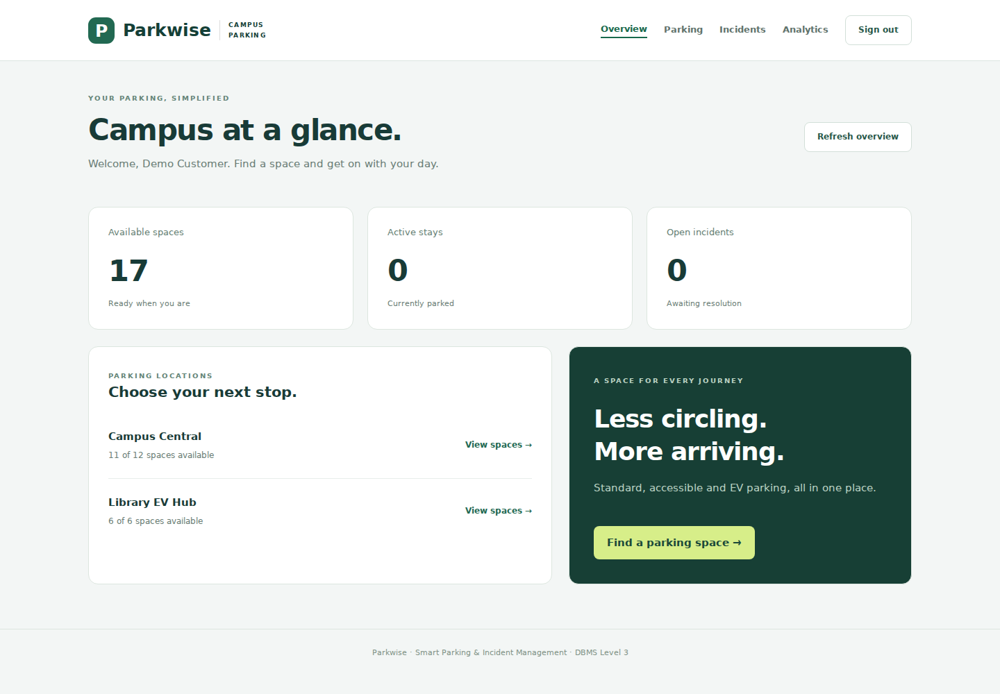
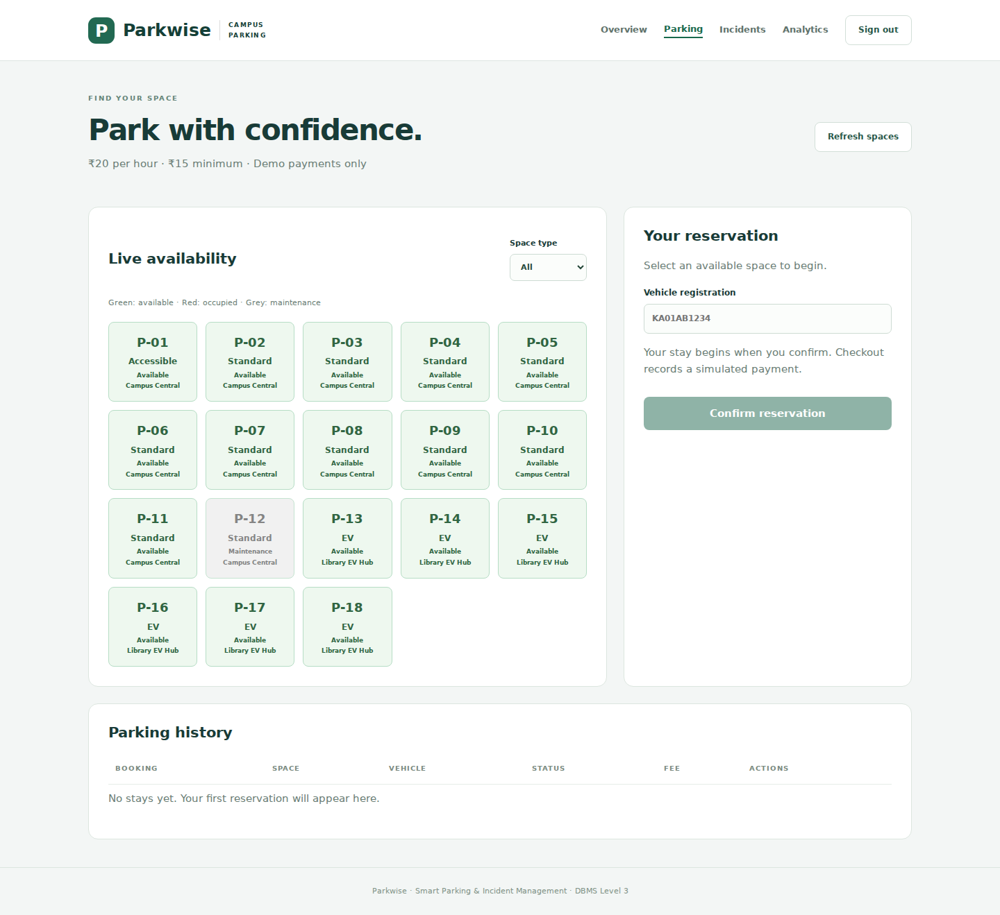
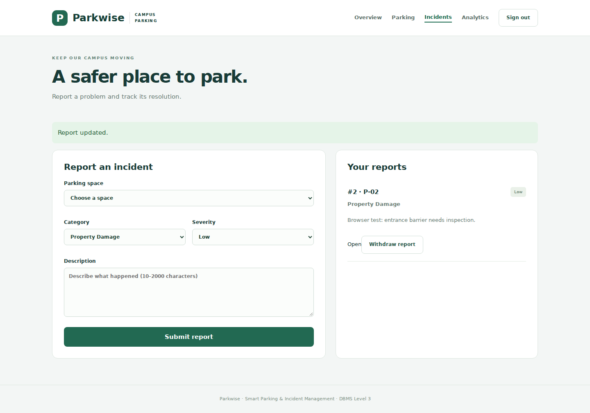
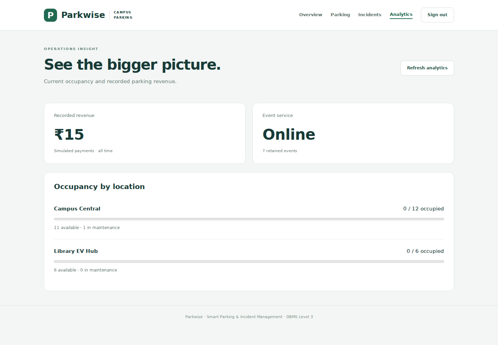
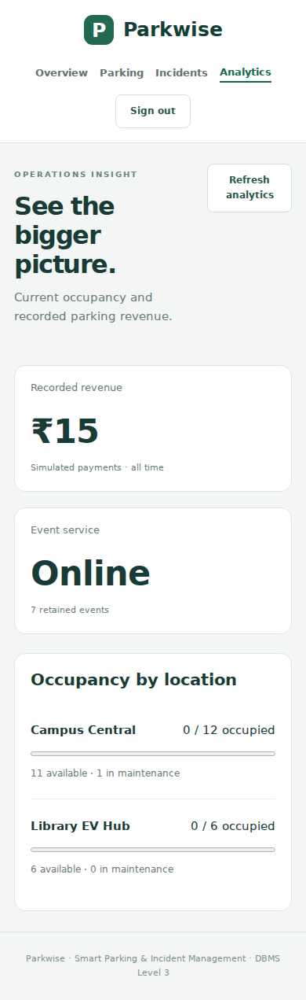

# Parkwise — Smart Campus Parking & Incident Management

A full-stack DBMS Level 3 project built with **Next.js**, **MySQL**, and **Redis**. Features multi-paradigm storage, role-based access control, concurrency-safe transactional parking reservations, dynamic fee calculation, incident tracking, and real-time database-backed analytics.



---

## 🌟 Key Highlights & DBMS Concepts

- **Dual-Database Architecture (Multi-Paradigm Storage)**:
  - **MySQL (Relational SQL)**: Authoritative system of record for users, vehicles, parking slots, bookings, payments, and incidents. Enforces strict ACID compliance, relational integrity, and business logic.
  - **Redis (In-Memory Key-Value NoSQL)**: High-speed caching, atomic login rate-limiting (sliding window TTL), active session tracking, and real-time event streaming.
- **Advanced Concurrency Control**:
  - Transactional slot reservation and checkout using pessimistic row-level locking (`SELECT ... FOR UPDATE`) to eliminate race conditions and double bookings.
  - Generated unique columns prevent simultaneous active bookings for the same parking slot or vehicle.
- **Relational Integrity & Schema Design**:
  - **Triggers**: `trg_release_slot` automatically updates parking slot status to `'Available'` whenever a booking is marked `'Completed'` or `'Cancelled'`.
  - **Stored Functions**: `calculate_parking_fee(p_booking_id)` computes parking fees dynamically based on elapsed duration ($20/hour with a $15 minimum; $0 on cancellation).
  - **Database Views**: `vw_active_occupancy` computes real-time lot occupancy metrics across standard, EV, and accessible bays.
  - **Composite Indexes & Constraints**: Optimized queries for lot availability, active user sessions, and incident statuses.
- **Security & Authentication**:
  - Role-Based Access Control (Customer vs. Staff/Admin).
  - Salted `scrypt` password hashing.
  - Cryptographically secure hashed session tokens stored with `HttpOnly`, `SameSite=Lax` cookies.

---

## 📸 Screenshots

| Parking Bay Grid | Incident Management |
| :---: | :---: |
|  |  |

| Operational Analytics | Mobile Responsive |
| :---: | :---: |
|  |  |

---

## 🛠️ Tech Stack

- **Frontend & Full-stack Framework**: Next.js (App Router, React 19, Tailwind CSS)
- **Primary Database**: MySQL 8.0+
- **Secondary Database**: Redis 7.0+
- **Database Driver**: `mysql2/promise` with connection pooling
- **Containerization**: Docker Compose v2
- **Testing**: Node.js Test Runner, Playwright

---

## 📋 System Requirements

- **Node.js**: Version 20+ (Node.js 24 LTS recommended)
- **Docker Desktop** (or local MySQL and Redis instances)
- **Ports required**: `3000` (Next.js web app), `3306` (MySQL), `6379` (Redis)

---

## 🚀 Quick Start

### Method 1: One-Click Launcher (Recommended)

Make sure **Docker Desktop** is running, then run the launcher:

- **Windows**: Double-click `start.cmd` or run:
  ```powershell
  .\start.cmd
  ```
- **macOS / Linux**: Run:
  ```bash
  chmod +x start.sh
  ./start.sh
  ```
- **Cross-Platform npm command**:
  ```bash
  npm run local
  ```

The launcher will:
1. Automatically generate private, secure credentials in `.env.local` (if not already present).
2. Install npm dependencies.
3. Start MySQL and Redis containers via Docker Compose.
4. Initialize the database schema and seed data.
5. Launch the Next.js development server and open `http://localhost:3000/login`.

---

### Method 2: Manual Setup with Docker Compose

1. **Clone the repository:**
   ```bash
   git clone https://github.com/Zaid5172/dbms_mini_pro.git
   cd dbms_mini_pro
   ```

2. **Configure Environment Variables:**
   ```bash
   cp .env.example .env.local
   ```
   *Edit `.env.local` to customize passwords and port configurations if needed.*

3. **Start MySQL & Redis Containers:**
   ```bash
   docker compose --env-file .env.local up -d --wait
   ```

4. **Install Dependencies & Initialize Database:**
   ```bash
   npm install
   npm run db:init
   ```

5. **Start Development Server:**
   ```bash
   npm run dev
   ```
   Access the application at [http://localhost:3000/login](http://localhost:3000/login).

---

## 🔑 Default Demo Accounts

When the database is initialized with `npm run db:init`, the following accounts are seeded:

| Role | Email | Password | Permissions |
| :--- | :--- | :--- | :--- |
| **Customer** | `customer@parking.local` | `SEED_CUSTOMER_PASSWORD` (from `.env.local`) | Browse slots, reserve parking, checkout, report & withdraw own incidents |
| **Staff** | `staff@parking.local` | `SEED_STAFF_PASSWORD` (from `.env.local`) | View all bookings, inspect all incidents, update incident resolution status, view analytics |

*(Passwords generated by `start.cmd` / `npm run local` are saved directly in your private `.env.local` file).*

---

## 🔄 Updating an Existing Database

If you have existing Docker volumes and want to apply updates without wiping data:

```bash
# Run schema migrations
npm run db:migrate

# Audit constraints, triggers, and views
npm run db:audit
```

---

## 🧪 Testing & Validation

```bash
# Run unit & security tests (password hashing, injection checks)
npm test

# Run validation against a live MySQL/Redis instance
RUN_INTEGRATION=1 npm test

# Run database audit script
npm run db:audit

# Build project for production
npm run build

# Run optional Playwright browser end-to-end tests
npm run test:browser
```

---

## 📂 Project Architecture

```text
dbms_mini_pro/
├── .devcontainer/        # VS Code / Codespaces dev container configuration
├── .github/workflows/    # CI workflow for automated testing and builds
├── compose.yaml          # Docker Compose definition (MySQL 8 + Redis 7)
├── database/
│   ├── mysql_schema.sql  # DDL: tables, constraints, view, stored function, trigger
│   └── queries.sql       # Complex demonstration queries (joins, aggregations, locks)
├── docs/
│   ├── CONTRIBUTIONS.md  # Team contributions & responsibilities matrix
│   ├── DBMS_AUDIT.md     # Audit report verifying DBMS features & constraints
│   ├── PROJECT_REPORT.md # Full academic report, ER diagram & data dictionary
│   ├── REBUILD.md        # Requirement checklist & implementation notes
│   ├── TESTING.md        # Test suite documentation & evidence
│   └── screenshots/      # Application screenshots
├── scripts/
│   ├── audit-db.cjs      # Validates live schema integrity and constraints
│   ├── db-connection.cjs # Database connection helper for Node scripts
│   ├── init-db.cjs       # Database initialization & seeding runner
│   ├── migrate-db.cjs    # Incremental migration helper
│   └── start-local.cjs   # Cross-platform one-click launcher script
├── src/
│   ├── app/              # Next.js App Router (pages and API endpoints)
│   │   ├── analytics/    # Real-time analytics dashboard
│   │   ├── api/          # REST API endpoints (auth, bookings, incidents, slots)
│   │   ├── incidents/    # Incident reporting & management interface
│   │   ├── login/        # Authentication & role-switch portal
│   │   └── parking/      # Parking bay slot reservation grid
│   ├── components/       # Reusable React UI components (Navigation, Header)
│   └── lib/              # Database connections (mysql, redis), auth & security helpers
├── tests/                # Test suites (security, DBMS audit, integration)
├── start.cmd             # One-click launcher for Windows
└── start.sh              # One-click launcher for macOS / Linux
```

---

## 📚 Detailed Documentation

- **[Full Project Report, ER Diagram & Data Dictionary](docs/PROJECT_REPORT.md)**
- **[DBMS Audit & Verification Results](docs/DBMS_AUDIT.md)**
- **[Demonstration SQL Queries](database/queries.sql)**
- **[Testing Evidence & Test Matrix](docs/TESTING.md)**
- **[Implementation Checklist & Architecture Notes](docs/REBUILD.md)**
- **[Team Responsibilities & Contribution Matrix](docs/CONTRIBUTIONS.md)**

---

## 🔒 Security & Safe Operations

- **Environment File**: Never commit `.env.local` or files containing plain passwords to version control.
- **Rate Limiting**: Login endpoints enforce Redis-backed rate-limiting to mitigate brute-force attempts.
- **SQL Injection Prevention**: All queries utilize parameterized prepared statements through `mysql2`.
- **Payment Processing**: Payments in this coursework application are simulated for demonstration.
