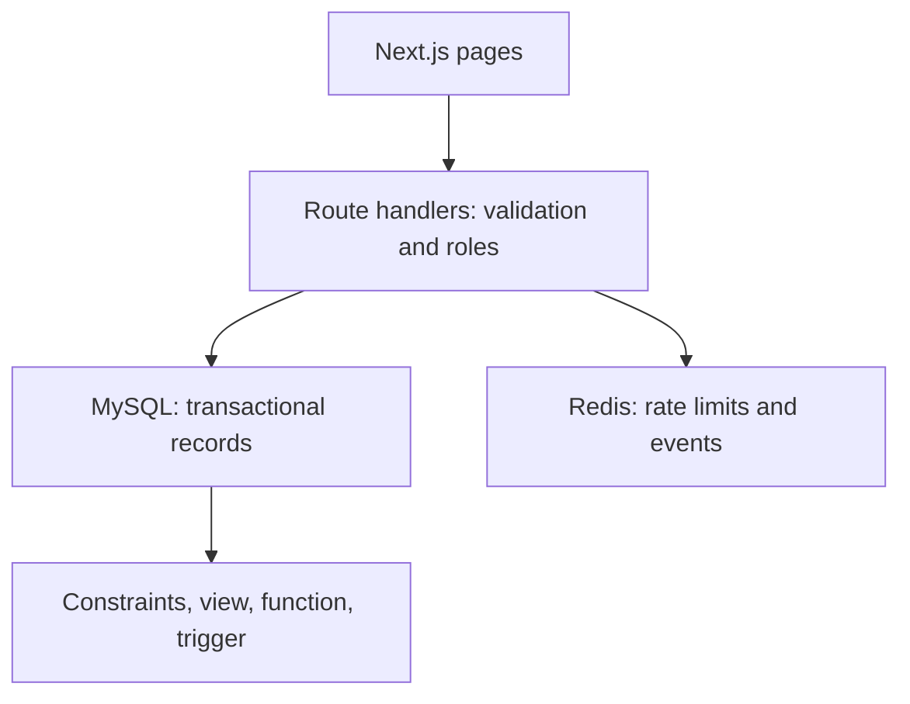

# Parkwise — DBMS Level 3 Project Report

## Problem, objectives and scope

Campus drivers waste time circling full parking areas, while staff have little visibility into unsafe parking and equipment faults. Parkwise provides a live space list, prevents conflicting reservations, records stays and simulated fees, and routes incident reports to staff.

Objectives: maintain consistent occupancy under concurrent requests; enforce customer/staff privileges; demonstrate at least four advanced database concepts; and provide a functional Next.js interface using at least two data paradigms.

Scope: immediate reservations, standard/EV/accessible spaces, registered vehicle ownership, completion/cancellation, incident lifecycle and operational analytics. Payments are simulated; there are no real payment transactions, sensors, timed future reservations, map navigation, email delivery or vector search. Accessibility type is descriptive; the system does not verify eligibility.

## Functional requirements

Customers sign in, browse/filter spaces, reserve one, see their own bookings, checkout or cancel, report problems, and withdraw their own open reports. Staff can additionally see all bookings/incidents and update incident status. Both roles see aggregate campus analytics. The server enforces permissions regardless of client-side controls.

## Architecture

MySQL is authoritative for business records; Redis does not determine whether a space may be booked. Mutations commit before publishing events. A Redis failure cannot roll back a successful SQL booking; events can be lost and are not a guaranteed audit ledger. Login requires Redis for a shared fail-closed rate limit. Slot availability is queried directly from MySQL to avoid stale cache decisions.

## ER diagram

```mermaid
erDiagram
  USERS ||--o{ SESSIONS : authenticates
  USERS ||--o{ VEHICLES : owns
  USERS ||--o{ BOOKINGS : makes
  PARKING_LOTS ||--|{ PARKING_SLOTS : contains
  PARKING_SLOTS ||--o{ BOOKINGS : receives
  VEHICLES ||--o{ BOOKINGS : uses
  BOOKINGS ||--o| PAYMENTS : settles
  USERS ||--o{ INCIDENT_REPORTS : reports
  PARKING_SLOTS ||--o{ INCIDENT_REPORTS : concerns
```

## Relational schema and data dictionary

All IDs are integer primary keys unless noted. Full executable column definitions, lengths, defaults and constraints are in `database/mysql_schema.sql`.

| Table | Attributes and keys | Relationship / constraints |
| --- | --- | --- |
| users | user_id PK; name; email UNIQUE; password_hash; role; created_at | Roles Customer/Staff/Admin; no plaintext passwords |
| sessions | token_hash CHAR(64) PK; user_id FK; expires_at | User 1:N sessions; delete sessions with user; expiry index |
| parking_lots | lot_id PK; name; location; total_capacity | Capacity must be positive; capacity is seeded, not automatically synchronized with manual slot edits |
| parking_slots | slot_id PK; lot_id FK; slot_number; slot_type; status | Unique (lot_id, slot_number); lot/status index; one lot per slot |
| vehicles | vehicle_id PK; user_id FK; license_plate UNIQUE | One registered owner; plate normalized and validated in API |
| bookings | booking_id PK; user_id FK; slot_id FK; vehicle_id FK; entry_time; exit_time; total_fee; status; active_slot; active_vehicle | Generated UNIQUE active keys; nonnegative fee; exit >= entry; user/status index |
| payments | payment_id PK; booking_id FK UNIQUE; amount; payment_method; transaction_timestamp | One simulated payment per completed stay; nonnegative amount |
| incident_reports | incident_id PK; slot_id FK; user_id FK; category; description; severity; status; reported_at | Description 10–2000 chars; enums; status/severity index |

The design separates users, locations, spaces, vehicles, stays, payments and incidents to avoid repeating owner/location attributes in operational records. Incident lot is obtained through its slot, avoiding inconsistent slot/lot pairs. Ownership consistency is also enforced by a composite vehicle/owner foreign key; legal transition rules are enforced in transactional API code. Direct database administrators must use equivalent rules; not every workflow invariant is enforced for arbitrary manual SQL.

## Database choices and NoSQL model

MySQL supports joins, foreign keys, check constraints, durable financial records and concurrent row locking. Redis suits expiring counters and bounded chronological event streams. Redis is a key-value/stream NoSQL database; confirm this interpretation with the instructor, since the brief lists document/graph/vector examples.

| Redis key | Type | Fields / policy | Retrieval |
| --- | --- | --- | --- |
| login:SHA256(normalized-email) | integer string | Attempt count, 300 second TTL, atomic INCR/EXPIRE in Lua; maximum 20 per interval | EVAL on each login attempt |
| parking:events | stream | type, id; Redis generated event ID; approximate MAXLEN 1000 | XLEN for diagnostics; XRANGE / XREAD for demonstration |

Booking and incident events are best effort notifications; SQL remains authoritative. Stream persistence is enabled with AOF in Compose, with a named volume. This is not a message-delivery guarantee. No embeddings or vector database are included; semantic search is optional and does not materially help space allocation.

## Advanced features and operations

1. **Transactions and row locking:** lock the selected space; validate availability; attach a vehicle owned by the authenticated user; insert booking and occupy the space in one transaction. Generated unique indexes provide an additional conflict barrier.
2. **View:** `vw_active_occupancy` joins lots and spaces, aggregates Available/Occupied/Maintenance, and feeds the dashboard/analytics.
3. **Function:** `calculate_parking_fee` reads stay timestamps; charges ₹20 per fractional hour with ₹15 minimum; it is declared NOT DETERMINISTIC because active fees depend on current time.
4. **Trigger:** `trg_release_slot` releases a space on Active → Completed/Cancelled. Checkout locks the booking, sets exit/status, computes fee, inserts a unique payment, and commits atomically.
5. **Indexes:** slot/lot/status and booking/user/status indexes support lookup; generated unique active keys prevent conflicts; session expiry and incident status indexes support lifecycle operations.
6. **NoSQL atomic operation:** a Lua script combines Redis INCR and first-attempt EXPIRE into one atomic rate-limit operation.

DDL: CREATE tables/view/function/trigger in schema; ALTER and DROP demonstrated only against a disposable example table in `database/queries.sql`. DML: INSERT bookings/reports/payments, UPDATE booking/incident state, DELETE open owned reports and expired sessions, SELECT lists/analytics. Query examples include JOIN, GROUP BY, HAVING, ORDER BY, SUM/COUNT/AVG, subqueries and EXPLAIN.

## Integrity and security

Parameterized SQL; input lengths/enums/IDs; server-derived actor ID; ownership checks; scrypt with random per-password salts; random session tokens hashed in SQL; HttpOnly SameSite=Lax cookies with optional Secure; origin checks on browser mutation requests; no business data trusted from Redis. Logs do not intentionally print credentials. Demo seeds require explicit configured passwords.

Limits: no registration/password reset/MFA, no fine-grained audit trail, no distributed event outbox, no payment gateway, no enforced license plate ownership verification, no sensor integration, no formal load test, and no hardened public deployment. Admin is an allowed database role but currently uses staff privileges; the two demonstrated roles are Customer and Staff.

## Screenshots and validation

See `docs/screenshots/` and `docs/TESTING.md`. Screenshots are captured from the running app with real SQL and Redis connections; no fabricated dashboard values are used.

## Conclusion and future enhancements

Parkwise demonstrates multi-paradigm operational data management beyond basic CRUD through concurrency control, fee computation, relational invariants, automatic transitions and staff workflows. Future work: reliable transactional outbox delivery, admin maintenance controls, stronger ownership verification, automated backups, reservation time windows, tests for deadlock retries, accessibility auditing and production monitoring.
